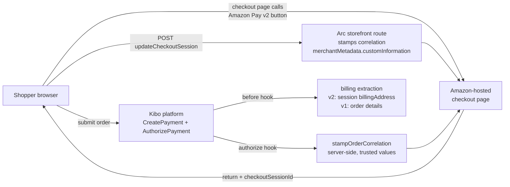

# PayWithAmazon — Arc.js Application

Integrates Amazon Pay (v2 and legacy v1) with the Kibo Commerce platform. An Arc.js
hosted-workflow app: the payment workflow actions run server-side on the platform, the
storefront routes proxy the browser to Amazon's checkout, and the site settings carry the
credentials.

## What this app does

| Capability | Where |
|---|---|
| Amazon Pay v2 checkout (checkout sessions, authorize, capture) | `assets/src/amazon/v2/` + the payment workflow actions |
| Legacy Amazon Pay v1 (MWS order references) | `assets/src/amazon/checkout.js` (v1 path) |
| Billing contact extraction (name, address, phone from Amazon) | `assets/src/amazon/checkout.js` — v2 from checkout session, v1 from MWS order details |
| Refund correlation stamping — links a refund to its Kibo order | `assets/src/amazon/paymenthelper.js` (server-side at `AuthorizePayment`) + `assets/src/domains/storefront/amazonUpdateCheckoutSession.js` (storefront route) |
| Declined-refund recording (`Failed` credit, not `Credited`) | `assets/src/amazon/paymenthelper.js` |
| Site settings (credentials, environment, sandbox toggle) | `assets/src/domains/platform.applications/` |
| Guard against tampered correlation blobs | `assets/src/domains/storefront/amazonUpdateCheckoutSession.js` |

## Architecture



## The refund IPN integration

This app stamps the **order correlation** — `{tenantId, siteId, orderId, paymentId?}` as
JSON — onto the Amazon Pay v2 charge permission's `merchantMetadata.customInformation`.
The refund IPN service (`kibo-paywithamazon-ipn`) reads that stamp to resolve a refund
notification back to its Kibo order and payment.

The correlation is stamped in **two places**, both from trusted server-side values:

1. **`AuthorizePayment` time** (`paymenthelper.stampOrderCorrelation`) — the authoritative
   stamp. Takes `orderId` from the payment object (a platform value, not browser-supplied).
   Runs regardless of the checkout frontend (headless or theme-driven), so it works even
   when the core theme is not updated. Skips the Amazon call when the checkout-session
   stamp already wrote the same values.

2. **The storefront `updateCheckoutSession` route** — the early stamp. Writes the
   correlation when the shopper returns from Amazon's checkout page (before the payment is
   created). Includes a guard that drops a browser-supplied correlation blob when
   tenant/site/order are incomplete, so a tampered or partial blob is never forwarded.

A declined refund carries `isDeclined: true` plus Amazon's reason code, so the manual
credit records as `Failed` instead of `Credited`.

## Billing contact extraction

On `CreatePayment`, the before-hook enriches the billing contact from Amazon:

| Path | Trigger | What it reads |
|---|---|---|
| **v2** — `getBillingInfoFromSession` | the payment's checkout session id | the v2 checkout session's `billingAddress` (name, address, phone) — gated on the site's `billingAddressOption` setting (non-zero = extract) |
| **v1** — `getBillingInfo` | the payment's MWS order reference id | the v1 MWS order's `BillingAddress.PhysicalAddress` — gated on the same setting |

For a v2 payment without `awsData` on the payment (the common case when the theme doesn't
carry it), the fallback reads the new payment's `externalTransactionId` — which for v2 IS
the checkoutSessionId — and routes it to the v2 session path.

## Site settings

Configured per site in the admin (**Settings → Payment & Checkout → PayWithAmazonV2**):

| Setting | Purpose |
|---|---|
| `isEnabled` | the checkout button + payment workflow gate |
| `merchantId`, `publicKeyId`, `privateKey`, `storeId` | Amazon Pay v2 credentials (site-scoped) |
| `environment` | `sandbox` or `live` |
| `region` | `na`, `eu`, `jp` |
| `captureOnAuthorize` | auto-capture at authorize time |
| `billingAddressOption` | non-zero = extract the full billing contact from Amazon's checkout session |

## Development

Arc.js app — standard workflow:

```bash
npm install          # dependencies
yo mozu-app --config # one-time: generate the upload config
grunt                # upload actions to Developer Center
grunt watch          # continuous upload during development
```

Tests (Arc.js `mozu-test-harness`):

```bash
npm test
```

## Payment workflow actions

The app intercepts `embedded.commerce.payments.action.performPaymentInteraction` for:

| Action | What this app does |
|---|---|
| `CreatePayment` | extracts the billing contact from Amazon; sets the external transaction id |
| `AuthorizePayment` | stamps the order correlation onto the charge permission; records declined refunds as `Failed` |
| `CapturePayment` | captures the Amazon charge |
| `CreditPayment` | creates the Amazon refund (IPN-driven settlement is handled by the IPN service) |
| `DeclinePayment`, `Rollback`, `VoidPayment` | the terminal states |

## The IPN service

The refund reconciliation is handled by the separate
[`kibo-paywithamazon-ipn`](https://github.com/Kibo-UCP/kibo-paywithamazon-ipn) service,
which receives the Amazon Pay v2 SNS notifications and applies the refund outcome to
CommerceRuntime. The integration flow is documented on
[Confluence](https://kibo.atlassian.net/wiki/spaces/EN/pages/138716807170).
